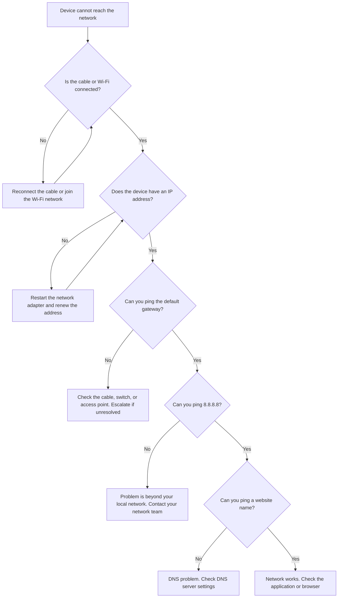

# Troubleshooting guide: Device cannot reach the network

> **Sample note:** This is a generic documentation sample. It contains no confidential employer or customer information.

**Audience:** Office staff and first-line support who need to find out why a computer cannot connect to the network or the internet.
**Time:** 10 to 15 minutes.

Use this guide when a computer shows "No internet" or cannot open websites or shared resources. Work through the steps in order. Stop when the problem is fixed.

## Decision flow



## Before you begin

- Open a terminal. On Windows, search for **Command Prompt**. On macOS or Linux, open **Terminal**.
- Write down what you see at each step. If you need to escalate, this information saves time.

## Step 1: Check the physical connection

1. For a wired connection, check that the cable is firmly plugged into the computer and the wall port or switch. Look for a link light near the port.
2. For Wi-Fi, check that Wi-Fi is turned on and that the computer is joined to the correct network.

If the connection was loose, reconnect it and test again. If not, continue.

## Step 2: Check the IP address

An IP address identifies your device on the network.

- **Windows:** run `ipconfig`
- **macOS or Linux:** run `ifconfig` (or `ip addr` on many Linux systems)

Find the address for your active connection.

| What you see | What it means | What to do |
|--------------|---------------|------------|
| An address such as `192.168.1.25` | The device has a valid address. | Go to Step 3. |
| An address starting with `169.254` | The device did not receive an address from the network. | Disconnect and reconnect, or restart the network adapter. On Windows, run `ipconfig /release` then `ipconfig /renew`. Then check again. |
| No address | The connection is down. | Return to Step 1. |

## Step 3: Test the default gateway

The default gateway is the router that connects your device to other networks. Its address appears in the `ipconfig` output as **Default Gateway**.

Run:

```
ping <gateway address>
```

Replace `<gateway address>` with the address you found, for example `ping 192.168.1.1`.

- **Replies received:** your device can reach the router. Go to Step 4.
- **"Request timed out" or "Destination unreachable":** the problem is between your device and the router. Check the cable, the switch, or the Wi-Fi signal. If this does not help, escalate.

## Step 4: Test the internet by IP address

Run:

```
ping 8.8.8.8
```

- **Replies received:** your connection to the internet works. Go to Step 5.
- **No replies:** the problem is beyond your local network, for example with your internet provider or the router's internet connection. Contact your network team.

## Step 5: Test name resolution

DNS translates website names into IP addresses. Run:

```
ping example.com
```

- **Replies received:** the network and DNS both work. The problem is likely with the application or browser. Restart it, or try another one.
- **"Could not find host" or similar:** DNS is not working. Check that the device is using the correct DNS server, or ask your network team for the correct address.

## When to escalate

Contact your network team if:

- You completed all steps and the problem remains.
- Several devices have the same problem. This suggests a fault in shared equipment.

Give them this information:

- Your device name and location
- The time the problem started
- Your IP address and default gateway
- The result of each ping test

---

*Authoring note: [Add your own note here. For example: "I wrote this from my knowledge of TCP/IP and checked each command on my own computer. An AI assistant helped draft the flowchart, which I corrected."]*
